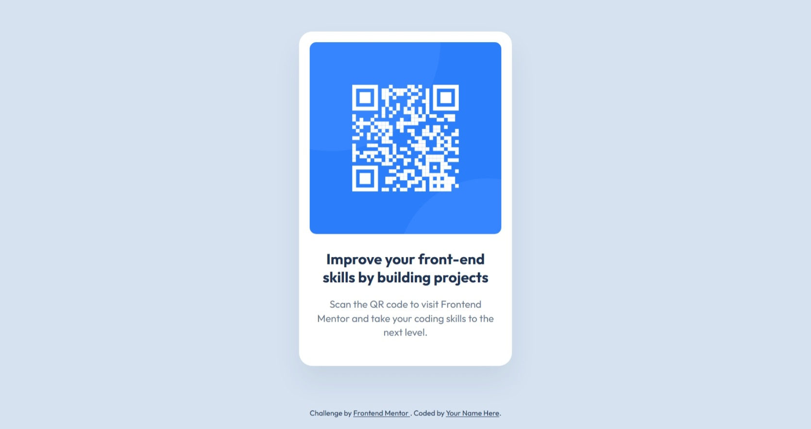

# Frontend Mentor Projects

A growing collection of [Frontend Mentor](https://www.frontendmentor.io/) challenges completed by [Luminal Collective](https://github.com/luminalcollective). The goal is to strengthen frontend fundamentals through practical projects, with an emphasis on semantic HTML, responsive layouts, maintainable CSS and accessibility.

**Portfolio:** https://luminalcollective.github.io/frontend-mentor/  
**Repository:** https://github.com/luminalcollective/frontend-mentor

> The portfolio URL assumes this repository is named `frontend-mentor` and GitHub Pages publishes from the repository root on the `main` branch.

## Projects

| Challenge | Live demo | Source | Technologies |
| --- | --- | --- | --- |
| QR Code Component | [View project](https://luminalcollective.github.io/frontend-mentor/projects/qr-code-component/) | [View files](./projects/qr-code-component/) | HTML, CSS |



## Repository structure

```text
frontend-mentor/
├── index.html                  # Portfolio homepage
├── README.md                   # Repository overview
└── projects/
    └── qr-code-component/
        ├── index.html
        ├── README.md
        ├── css/
        │   └── style.css
        └── images/
            ├── image-qr-code.png
            ├── favicon-32x32.png
            └── qrcode-screenshot.jpeg
```

Each challenge lives in its own folder with its own assets and documentation. The root `index.html` serves as the portfolio index.

## Running locally

1. Clone the repository:
   ```bash
   git clone https://github.com/luminalcollective/frontend-mentor.git
   ```
2. Open `index.html` in a browser to view the portfolio.
3. Open `projects/qr-code-component/index.html` to view the QR Code Component.

For these static HTML/CSS projects, no build step is required.

## Adding another challenge

1. Create a new folder under `projects/` using a descriptive, lowercase, hyphenated name.
2. Keep that challenge's `index.html`, CSS, images and README together in its folder.
3. Add a new project card to the root `index.html`.
4. Add a new row to the **Projects** table above.
5. Test the new project's relative asset paths and live URL after deployment.

## Accessibility and responsiveness

Projects aim to follow WCAG 2.2 AA principles. Accessibility is assessed per project rather than assumed: test keyboard navigation, visible focus, contrast, text resizing, zoom and layouts from 320px upward. Automated checks can help but do not replace manual testing.

## Acknowledgements

Challenges and design assets are provided by [Frontend Mentor](https://www.frontendmentor.io/). Implementations and portfolio organisation are by [Luminal Collective](https://github.com/luminalcollective).
